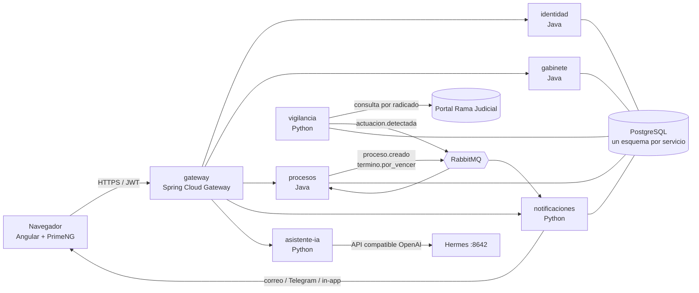

# 2. Arquitectura y organización técnica

> Las decisiones de este documento están registradas, con sus alternativas, en [`docs/adr/`](adr/).

## 2.1 Opciones evaluadas

| Opción | Pros | Contras |
|---|---|---|
| **A. Monolito modular** (un solo Spring Boot con módulos bien separados) | Lo más rápido de construir; un solo despliegue; poca RAM; fácil de depurar | No cumple el objetivo académico de microservicios; el scraping y la IA quedan incómodos en Java; todo escala junto |
| **B. Microservicios solo Java** (Spring Cloud completo: Eureka, Config Server, Gateway) | Un solo lenguaje; es lo que suele pedirse en la materia; mucho material de referencia | Mucha RAM (≈ 350–500 MB por servicio Java); el scraping web y la IA tienen menos herramientas en Java; Eureka y Config Server suman servicios que mantener |
| **C. Microservicios políglotas** (Java para el núcleo, Python para vigilancia, notificaciones e IA) — **elegida** | Cada parte usa la herramienta adecuada: Java/Spring para lo transaccional, Python (Playwright, httpx, clientes de IA) para scraping e IA; los servicios Python son livianos | Dos stacks que mantener y probar; los contratos (OpenAPI) y los eventos deben estar bien documentados; más piezas que desplegar |

**Por qué C:** el valor del producto está en dos cosas difíciles: vigilar un portal web sin API oficial y redactar con IA. Las dos se resuelven mejor en Python. El núcleo de datos (procesos, términos, honorarios) se beneficia del tipado y las transacciones de Spring.

### Otras decisiones

| Tema | Elegido | Alternativas y por qué no |
|---|---|---|
| Mensajería entre servicios | **RabbitMQ** | Kafka: excesivo para este volumen y pesado en RAM. REST síncrono: acopla los servicios y si uno está caído se pierden eventos. |
| Identidad y login | **JWT propio** (Spring Security), reutilizando la tabla `usuarios` | Keycloak: completo pero usa ≈ 700 MB de RAM y es mucha configuración para esta etapa. |
| Descubrimiento de servicios | **DNS de Docker Compose** (`http://procesos:8080`) | Eureka: otro servicio Java más; no hace falta con Compose en un solo servidor. |
| Base de datos | **PostgreSQL 16**, una instancia con **un esquema por servicio** | Una base por contenedor: más aislamiento pero más RAM. MySQL: menos soporte de JSON y de funciones de fechas. |
| Fuente de la Rama Judicial | Interfaz `FuenteRamaJudicial` con implementación intercambiable | Ver [ADR 0005](adr/0005-vigilancia-rama-judicial.md). |
| Frontend | **Angular 21 + PrimeNG** (base: `gestion-juridica-frontend`) | `gabinete.html` actual: útil como prototipo, pero no escala a muchas vistas. |
| IA | **Hermes** del servidor (API compatible con OpenAI, `:8642`) | API de Claude: mejor calidad pero con costo. El servicio usa un cliente compatible con OpenAI, así que cambiar de proveedor es configuración. |

## 2.2 Vista general



## 2.3 Servicios

| Servicio | Tecnología | Responsabilidad | Esquema BD | Publica / consume |
|---|---|---|---|---|
| `gateway` | Spring Cloud Gateway | Punto de entrada único: rutas, CORS, validación del JWT | — | — |
| `identidad` | Spring Boot 3 · Java 17 | Login, emisión de JWT, usuarios y roles | `identidad` | — |
| `gabinete` | Spring Boot 3 · Java 17 (evoluciona el código actual de `src/`) | Firma, sedes, áreas de práctica, abogados, clientes, peritos, tarifas, honorarios y pagos | `gabinete` | — |
| `procesos` | Spring Boot 3 · Java 17 | Procesos y radicado, partes, asignaciones, actuaciones, providencias, pruebas, términos y calendario judicial | `procesos` | Publica `proceso.creado`, `termino.por_vencer`, `termino.vencido`. Consume `actuacion.detectada`. |
| `vigilancia` | Python · FastAPI · APScheduler | Consulta periódica de cada radicado activo y detección de actuaciones nuevas | `vigilancia` | Publica `actuacion.detectada`. Consume `proceso.creado`. |
| `notificaciones` | Python · FastAPI | Envía avisos por correo (SMTP), Telegram y dentro de la app (SSE); guarda el historial | `notificaciones` | Consume `actuacion.detectada`, `termino.por_vencer`, `termino.vencido`. Publica `notificacion.enviada`. |
| `asistente-ia` | Python · FastAPI | Borradores de demanda y contestación, resumen de autos | — | — |
| `frontend` | Angular 21 + PrimeNG servido por nginx | Interfaz web. Llama solo al gateway. | — | — |

**Regla de datos:** cada servicio es dueño de su esquema. **No hay llaves foráneas entre esquemas**: un proceso guarda `id_cliente` y `id_abogado` como números, y quien necesita el nombre lo pide a `gabinete` por API. Así un servicio puede cambiar su modelo sin romper a los demás.

## 2.4 Eventos (RabbitMQ, exchange `gabinete.eventos` tipo topic)

| Evento | Lo publica | Contenido mínimo | Lo consume |
|---|---|---|---|
| `proceso.creado` | procesos | `id_proceso`, `radicado`, `id_abogado_responsable` | vigilancia (empieza a vigilarlo) |
| `actuacion.detectada` | vigilancia | `radicado`, `fecha`, `tipo`, `descripcion`, `fuente` | procesos (la registra), notificaciones (avisa) |
| `termino.por_vencer` | procesos | `id_termino`, `id_proceso`, `vence`, `dias_habiles_restantes`, `id_abogado` | notificaciones |
| `termino.vencido` | procesos | igual que el anterior | notificaciones |
| `notificacion.enviada` | notificaciones | `id_notificacion`, `canal`, `destinatario` | (auditoría) |

Los contratos detallados (OpenAPI de cada servicio y esquema JSON de cada evento) irán en `docs/contratos/` **antes** de escribir el código del servicio.

## 2.5 Orden del repositorio

```
Abogados/
├─ servicios/
│  ├─ gateway/          Java · Spring Cloud Gateway
│  ├─ identidad/        Java · Spring Boot 3
│  ├─ gabinete/         Java · Spring Boot 3 (código actual de src/ migrado)
│  ├─ procesos/         Java · Spring Boot 3
│  ├─ vigilancia/       Python · FastAPI
│  ├─ notificaciones/   Python · FastAPI
│  └─ asistente-ia/     Python · FastAPI
├─ frontend/            Angular 21 + PrimeNG
├─ db/
│  ├─ schema/           DDL por esquema
│  ├─ seed/             Datos de prueba
│  └─ consultas/        Consultas de ejemplo
├─ infra/
│  ├─ docker-compose.yml
│  └─ .env.example
└─ docs/
   ├─ 01-dominio.md
   ├─ 02-arquitectura.md
   ├─ 03-roadmap.md
   ├─ adr/              Decisiones de arquitectura
   └─ contratos/        OpenAPI y eventos
```

Mientras dure la fase F1, el código actual de `src/` sigue funcionando en la raíz; se mueve a `servicios/gabinete/` cuando esté migrado y probado.

## 2.6 Convenciones

- **Arquitectura interna de cada servicio: hexagonal**, igual que en `gestion-juridica-Back`:
  - `dominio/`: modelo y reglas, sin dependencias de frameworks.
  - `aplicacion/`: casos de uso (servicios).
  - `infraestructura/`: REST, JPA o SQL, RabbitMQ y clientes HTTP.
- **Contrato primero:** se escribe el OpenAPI del servicio y se revisa antes del código.
- **Ramas:** `main` siempre estable; trabajo en `feature/<tema>`; merge con pull request.
- **Commits:** convencionales (`feat:`, `fix:`, `docs:`, `test:`, `refactor:`).
- **Pruebas:** cada servicio trae las suyas. Java usa JUnit 5 + Testcontainers con PostgreSQL; Python usa pytest. La base de pruebas de `db/` sirve para pruebas manuales y demos.
- **Idioma:** dominio y código en español, como el proyecto actual.

## 2.7 Despliegue en el servidor

Todo corre en la VM docker (`ssh docker`, `~/proyectos/abogados`), accesible solo por Tailscale.

- `docker compose` para todo; imágenes con versión fija (`postgres:16-alpine`, `rabbitmq:3.13-management-alpine`, `eclipse-temurin:17-jre-alpine`, `python:3.12-slim`).
- Cada servicio con `restart: unless-stopped`, `healthcheck`, `mem_limit` y logs rotados (`max-size: 10m`, `max-file: 3`).
- PostgreSQL y RabbitMQ **sin puertos publicados**: solo los ven los servicios por la red interna. Solo se publican el gateway y el frontend.
- Secretos en `infra/.env` (fuera de git); el repositorio trae `infra/.env.example`.
- **Puertos del servidor:** usar el rango **8090–8099** (frontend 8090, gateway 8091). Están ocupados 22, 3000, 3001, 5432, 6379, 8000, 8080, 8642, 9000, 9001 y 9119.

### Presupuesto de memoria (aprox.)

| Componente | `mem_limit` |
|---|---|
| gateway | 384 MB |
| identidad, gabinete, procesos | 384 MB c/u |
| vigilancia (con Playwright) | 512 MB |
| notificaciones, asistente-ia | 192 MB c/u |
| PostgreSQL | 512 MB |
| RabbitMQ | 256 MB |
| frontend (nginx) | 64 MB |
| **Total** | **≈ 3,3 GB** |

La VM tiene ≈ 9,6 GB y ya corren Hermes (≈ 2 GB) y whatsapp-ai-saas. Antes de desplegar hay que verificar la RAM libre con `D:\projects\servidor\estado-servidor.ps1` y dejar al menos 1,5 GB libres.
