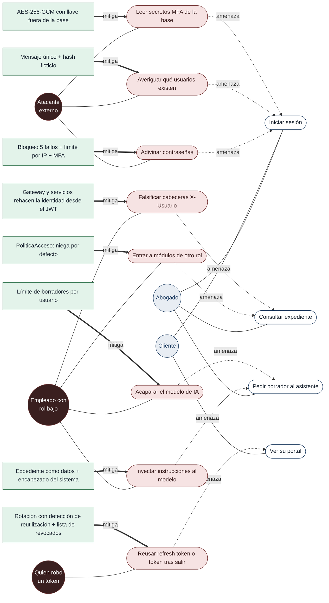

# Casos de abuso (fase F16)

## Qué es un caso de abuso

Un **caso de uso** describe lo que una persona legítima quiere lograr con el sistema. Un **caso de abuso** describe lo que un atacante quiere lograr, contado de la misma forma: un actor, una meta y los pasos para alcanzarla. Sirve para pensar en la seguridad desde los requisitos, antes de escribir el código, y no solo al final con una prueba de penetración.

**Gary McGraw** lo pone como uno de los siete *touchpoints* de su libro *Software Security: Building Security In* (2006). Son siete prácticas de seguridad que se aplican sobre los artefactos que el equipo ya produce:

1. Revisión de código.
2. Análisis de riesgo de la arquitectura.
3. Pruebas de penetración.
4. Pruebas de seguridad basadas en riesgo.
5. **Casos de abuso.**
6. Requisitos de seguridad.
7. Operación segura.

McGraw explica los casos de abuso con una idea simple: el equipo diseña pensando en lo que el sistema debe hacer y el atacante piensa en lo que el sistema **no debería permitir**. Escribirlos obliga a "pensar como el atacante". También alimentan dos de los otros puntos:
- los **requisitos de seguridad**: cada caso de abuso pide un control;
- las **pruebas basadas en riesgo**: cada control necesita una prueba que intente el abuso y falle.

El diagrama usa la notación de *misuse cases* (Sindre y Opdahl, 2005), que McGraw retoma:
- **Actor malicioso:** dibujado en otro color.
- **Caso de abuso:** se relaciona con el caso de uso que **amenaza**.
- **Control:** es un caso de uso o requisito que **mitiga** el abuso.

## Cómo lo hicimos

1. **Casos de uso.** Partimos de los casos de uso que manejan lo más valioso: credenciales, expedientes, borradores del asistente y facturas.
2. **Atacantes.** Para cada caso de uso nos preguntamos quién querría abusar de él:
   - **Externo:** sin cuenta, dentro de la VPN o con un equipo robado.
   - **Interno:** con un rol bajo que quiere ver más.
   - **Con un token robado:** alguien que obtuvo un token o una cookie.
3. **Casos de abuso.** Escribimos cada uno como "el atacante quiere…".
4. **Control y prueba.** Ubicamos el control en el código y la prueba automática que intenta el abuso. Donde no había prueba, la agregamos (marcadas como **F16**).

## Diagrama

## Catálogo

| # | Caso de abuso: el atacante quiere… | Control | Dónde | Prueba que intenta el abuso |
|---|---|---|---|---|
| 1 | Adivinar la contraseña probando muchas | 5 fallos bloquean la cuenta 15 min (423). Más de 100 intentos por IP en 10 min (429). Los códigos MFA incorrectos también cuentan | `Usuario.java`, `LimiteIntentosPorIp.java`, `MfaServicio.java` | `AutenticacionTest.cincoFallosBloqueanQuinceMinutosAunqueLuegoAcierte`, `AuthRecursoTest.superarElLimiteDeIntentosPorIpEsUn429`, `MfaTest.cincoCodigosIncorrectosBloqueanLaCuenta` |
| 2 | Saber qué usuarios existen, por el mensaje o por el tiempo de respuesta | El mismo mensaje en los dos casos. Si el usuario no existe, igual se compara un hash BCrypt ficticio | `AutenticacionServicio.java` | `elMensajeNoRevelaSiFallaElUsuarioOLaClave` y **F16** `unUsuarioInexistenteTambienPagaElCostoDeBCrypt` |
| 3 | Entrar a módulos de otro rol (un DEPENDIENTE a honorarios, un CLIENTE a procesos ajenos) | `PoliticaAcceso`: aplica la primera regla que coincide y niega todo lo que no está en la tabla. El servicio vuelve a verificar | `gateway/PoliticaAcceso.java` | `SeguridadTest.cadaRolLlegaSoloASusRutas`, `unRolSinPermisoEsUn403`, `elClienteSoloVeSuPerfilSuPortalYSusAvisos` |
| 4 | Hacerse pasar por otro enviando `X-Usuario-Id` o `X-Usuario-Roles` | El gateway descarta esas cabeceras y las rehace desde el token. Cada servicio verifica el JWT por JWKS | `IdentidadEnCabeceras.java`, `seguridad.py` | `SeguridadTest.lasCabecerasDeIdentidadSeReescribenConLasDelToken`, `test_seguridad.py::test_la_identidad_sale_del_token` |
| 5 | Usar un token falso, firmado por otro o con `alg: none` | RS256 obligatorio, emisor y vencimiento verificados | `ConfiguracionSeguridad.java`, `seguridad.py` | `SeguridadTest.unTokenFalsoEsUn401`, `test_sin_token_con_firma_ajena_o_vencido_es_401` |
| 6 | Reusar un refresh token robado | Rotación por familia: si llega uno ya gastado, se revoca toda la familia y los tokens de acceso vigentes | `SesionesServicio.java` | `SesionesTest.usarDosVecesElMismoRefreshTokenCierraLaSesionYCortaLosTokensVigentes` |
| 7 | Seguir usando un token después de cerrar sesión | Lista de revocados (gateway e identidad) y token de acceso de 15 min | `ListaRevocados.java` | `SesionesTest.cerrarSesionInvalidaElRefreshTokenYElTokenDeAcceso`, `SeguridadTest.unTokenRevocadoOUnTokenDeServicioNoSirvenDesdeFuera`, `RevocacionEnIdentidadTest` |
| 8 | Usar una cuenta con clave temporal sin cambiarla | Con clave temporal solo se puede ver el perfil y cambiar la clave | `PoliticaAcceso.java` | `SeguridadTest.conClaveTemporalSoloSePuedeCambiarLaClave` |
| 9 | Robar la base y leer los secretos MFA | Secretos cifrados con AES-256-GCM. La llave vive en `infra/.env`, no en la base | `CifradorAesGcm.java` | `MfaTest.elSecretoCifradoNoSeLeeConOtraLlave` |
| 10 | Meter instrucciones en una actuación para que el modelo haga otra cosa | El expediente va como datos, no como instrucciones. El modelo no tiene herramientas. Encabezado y firma los arma el sistema | `asistente-ia/app/dominio.py` | `test_el_texto_del_expediente_va_como_dato_y_el_modelo_lo_sabe`, `test_el_encabezado_lo_pone_el_sistema_no_el_modelo` |
| 11 | Acaparar el modelo pidiendo borradores sin parar (Ollama atiende uno a la vez) | **F16:** máximo 5 borradores por usuario cada 10 min (429), con registro de uso por usuario | `asistente-ia/app/aplicacion.py`, `main.py` | **F16** `test_api_responde_429_al_superar_el_limite_y_registra_al_usuario`, `test_limite_de_borradores_por_usuario_en_ventana_deslizante` |

**Comprobado en el servidor (2026-10-27).** Con un abogado se pidieron seis borradores seguidos: los cinco primeros pasaron el límite y el sexto recibió 429 con el mensaje "Pidió demasiados borradores seguidos…". La línea `AUDITORIA` del gateway registró el usuario y el 429.

## Lo que queda abierto

- **No repudio:** la bitácora `AUDITORIA` no es inalterable (ver `docs/04`, brecha de no repudio).
- **Límites en memoria:** los dos límites, por IP y por usuario, viven en memoria. Si algún día hay varias instancias, deben pasar a un almacén compartido.
