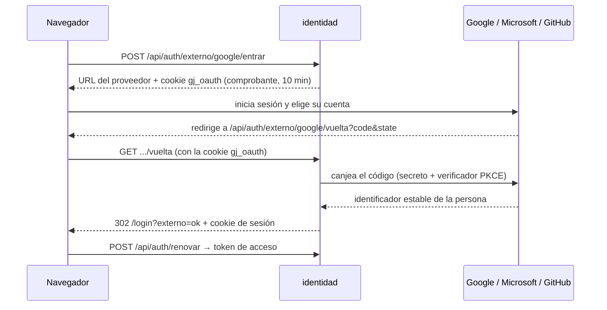

# Privacidad, cookies y acceso con Google, Microsoft o GitHub

## 1. Política de privacidad y de cookies

| Qué | Dónde |
|---|---|
| Política de tratamiento de datos personales | `/privacidad` (pública, sin sesión) |
| Política de cookies | `/cookies` (pública) |
| Aviso de cookies | Abajo en cualquier pantalla, la primera vez y cada vez que cambie la versión |
| Datos del responsable y versión | `frontend/src/app/legal/datos-legales.ts` |
| Enlaces | Pie del login, aviso de cookies y menú del usuario («Privacidad y cookies») |

**Base legal:**
- **Ley 1581 de 2012 y Decreto 1377 de 2013** (compilado en el Decreto 1074 de 2015):
  - responsable del tratamiento;
  - datos que se tratan y finalidades;
  - datos sensibles y de menores;
  - derechos del titular (art. 8);
  - plazos de respuesta: 10 días hábiles para consultas y 15 para reclamos (arts. 14 y 15);
  - encargados, seguridad y conservación.
- **Secreto profesional:** el texto menciona el del abogado.

**Para dejarla lista falta:**
1. **Datos de la firma:** llenar los `[COMPLETAR]` de `datos-legales.ts`: NIT, dirección, correo para datos personales y teléfono. El plazo de conservación se completa en la sección 9 de `privacidad.component.ts`.
2. **Revisión jurídica:** que un abogado de la firma revise el texto. Después, poner `revisada: true` para quitar el aviso de borrador.
3. **Cambios futuros:** al cambiar el texto, subir `version`. El aviso de cookies vuelve a salir.

**Aviso de cookies sin «Aceptar / Rechazar»:**
- **Qué guarda la app:** solo lo necesario para la sesión y algunas preferencias propias (tema y menú). La lista exacta está en `ALMACENAMIENTO`.
- **Qué no tiene:** analítica, publicidad ni cookies de terceros.
- **Por eso:** no hay nada opcional que consentir. El aviso informa y se cierra con «Entendido».
- **Si algún día se agrega analítica:** habrá que pedir consentimiento previo y separado.

## 2. Entrar con Google, Microsoft o GitHub

**Regla:** solo cuentas que ya existen.
- **Cómo se enlaza:** la persona entra con su usuario y contraseña y, en «Mi cuenta → Cuentas para entrar», enlaza su cuenta de Google, Microsoft o GitHub. Desde entonces puede entrar con ella.
- **Lo que nunca pasa:** no se crean cuentas, ni se enlaza nada solo porque coincida el correo. Alguien podría tener ese mismo correo en otro proveedor.



**Seguridad:**

| Riesgo | Control |
|---|---|
| Robo del código en la vuelta | PKCE S256: el verificador nunca sale del servidor |
| Alguien hace entrar a otra persona con su propia cuenta (*login CSRF*) | Estado de un solo uso, guardado como hash y atado al navegador con la cookie `gj_oauth` (HttpOnly, `SameSite=Lax`) |
| Repetir una vuelta | El estado se borra al leerlo (`DELETE … RETURNING`); vence a los 10 min |
| Hacerse pasar por otro con el mismo correo | Se identifica por el `sub` (OIDC) o el `id` (GitHub), nunca por el correo |
| Saltarse la verificación en dos pasos | Se sigue pidiendo. El desafío vuelve en el fragmento `#`, que no llega a ningún servidor |
| Cuenta bloqueada o desactivada | Mismas reglas que con contraseña; el intento queda en la bitácora (`EXTERNO_GOOGLE`, …) |
| Enlace no autorizado | Aviso de seguridad a la persona al enlazar y al quitar |

### Cómo activar cada proveedor (lo hace Javier)

**Antes de empezar:**
- `URL_PUBLICA` debe estar en `infra/.env`; hoy ya lo está.
- La dirección de vuelta que se registra en cada proveedor es:

```
{URL_PUBLICA}/api/auth/externo/google/vuelta
{URL_PUBLICA}/api/auth/externo/microsoft/vuelta
{URL_PUBLICA}/api/auth/externo/github/vuelta
```

**Funciona aunque la app no esté publicada en internet.** El proveedor redirige al navegador, no al servidor, así que basta con estar en la VPN. Solo identidad sale a internet, para canjear el código.

**Google** (Google Cloud Console):
1. APIs y servicios → Pantalla de consentimiento de OAuth: tipo externo, con los permisos `openid`, `email` y `profile`.
2. Credenciales → Crear ID de cliente de OAuth → Aplicación web. En «URI de redireccionamiento autorizados» va la dirección de Google de arriba.
3. Copiar el ID y el secreto a `GOOGLE_CLIENT_ID` y `GOOGLE_CLIENT_SECRET`.

**Microsoft** (Microsoft Entra, «Registros de aplicaciones»):
1. Nuevo registro. Tipos de cuenta:
   - «Cualquier directorio y cuentas personales», si se usa `MICROSOFT_TENANT=common`;
   - o solo el directorio de la firma, poniendo su id en `MICROSOFT_TENANT`.
2. URI de redirección, tipo Web: la dirección de Microsoft de arriba.
3. «Certificados y secretos» → nuevo secreto de cliente.
4. Copiar el ID de la aplicación y el secreto a `MICROSOFT_CLIENT_ID` y `MICROSOFT_CLIENT_SECRET`. Anotar cuándo vence el secreto.

**GitHub** (Settings → Developer settings → OAuth Apps → New OAuth App):
1. *Authorization callback URL*: la dirección de GitHub de arriba.
2. Generar un *client secret*.
3. Copiar a `GITHUB_CLIENT_ID` y `GITHUB_CLIENT_SECRET`.

**Para terminar:**
- **Recargar:** después de escribir las variables en el servidor (`infra/.env`), ejecutar `docker compose up -d identidad`.
- **Sin configurar:** un proveedor sin identificador o sin secreto simplemente no aparece en el login.
- **Secretos:** nunca van en git ni en el chat.

## 3. Pruebas

| Dónde | Qué comprueba |
|---|---|
| `identidad/AccesoExternoTest` (9) | Enlazar y luego entrar. Sin enlace no entra, aunque coincida el correo. Estado de un solo uso, vencido o de otro navegador. PKCE (vector del RFC 7636). Se pide la verificación en dos pasos. Cuenta inactiva. Cuenta de otra persona. Una cuenta por proveedor y quitarla. Cancelación |
| `identidad/ProveedorOAuthTest` (5) | Contra un servidor local que imita al proveedor: URL de ida, canje con verificador y secreto, identidad OIDC, GitHub por id numérico, errores |
| `identidad/AccesoExternoRecursoTest` (5) | Cookie del flujo (Lax, 10 min), cabecera AJAX, redirecciones de la vuelta y fragmento del desafío |
| `frontend/legal.spec.ts` (3) | El aviso sale una vez por versión. La política de cookies lista todo lo guardado. La de privacidad tiene los datos y plazos de ley |
| `frontend/a11y.spec.ts` (+5) | Privacidad, cookies, aviso, login con proveedores y cuentas enlazadas, sin violaciones graves |

**Resultado:**
- identidad: 146 pruebas; gateway: 13; notificaciones: 64; frontend: 35.
- axe en el navegador sin violaciones graves en el login, `/privacidad` y `/cookies`, en claro y oscuro.
- Falta la prueba de punta a punta con cada proveedor real. Se hace cuando estén registradas las apps OAuth.
