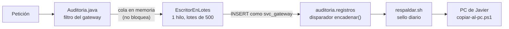

# Bitácora de auditoría con hash encadenado

Cierra la brecha de **no repudio** de `docs/04` (prioridad 8 del plan de mejora). Antes, el gateway solo escribía
una línea `AUDITORIA` en el log del contenedor: rotaba a los 30 MB y cualquiera con acceso a la VM podía editarla.

## 1. Qué se anota

Una fila por cada petición a `/api`, **también las rechazadas** (401 y 403). Antes esas no llegaban a la línea
`AUDITORIA`, porque la seguridad las cortaba antes del filtro.

| Campo | Contenido |
|---|---|
| `id` | Consecutivo sin huecos (1, 2, 3…). Lo pone la base |
| `momento` | Cuándo llegó la petición, en microsegundos |
| `usuario` / `roles` | Documento y roles del token, o `anonimo` (sin sesión o con un token inválido) |
| `metodo` / `ruta` | Por ejemplo, `DELETE /api/gastos/12`. Sin parámetros, porque ahí podría ir un token |
| `estado` / `duracion_ms` | Código HTTP y duración. `estado` vacío = el cliente cortó antes de la respuesta |
| `ip` | La que pone nginx en `X-Real-IP` |
| `hash_anterior` / `hash` | La cadena (sección 2) |

**Lo que no se guarda:** cuerpos de las peticiones, respuestas, parámetros ni datos del expediente. Los preflight de
CORS y `/actuator/health` tampoco se anotan, porque no son acciones de nadie.

**Detalle del inicio de sesión:** los ingresos se siguen guardando con su motivo (clave incorrecta, bloqueado…) en
`identidad.ingresos`. La bitácora de auditoría los ve como `anonimo` → `POST /api/auth/login`.

**Lo que no pasa por el gateway** no queda en esta bitácora. En particular, las consultas al bot de Telegram tienen su propio registro, sin el texto de la consulta: `notificaciones.consultas_bot` (ver `docs/15-bot-telegram.md`).

## 2. Cómo funciona la cadena



Cada registro guarda el hash del anterior; el primero encadena con 64 ceros:

```text
hash = SHA-256( id \n momento UTC con microsegundos \n usuario \n roles \n método \n ruta \n estado|- \n
                duración \n ip|- \n hash anterior )
```

- **Quién calcula:** el hash lo calcula la base al guardar (disparador `auditoria.encadenar`, con un candado para
  que dos escrituras a la vez no se crucen). El gateway no puede mandar ni el número ni el hash: la base los
  reemplaza.
- **Quién revisa:** la revisión se hace dos veces, por separado.
  - El gateway recalcula cada hash en Java (`Cadena.java`), sin usar funciones de la base.
  - El vigía usa `auditoria.verificar()` en SQL.
- **Mismo resultado:** los dos cálculos coinciden con un vector calculado aparte en Python (`CadenaTest` y
  `db/pruebas/015-auditoria.sql`).

## 3. Qué la protege

| Intento | Qué lo impide o lo delata |
|---|---|
| Cambiar o borrar registros con el usuario del gateway | `svc_gateway` solo tiene `INSERT` y `SELECT` |
| Cambiar, borrar o vaciar con el dueño de la tabla | Disparadores que rechazan `UPDATE`, `DELETE` y `TRUNCATE` |
| Saltarse los disparadores (superusuario) y cambiar un registro | La cadena deja de cuadrar desde ese registro: el contenido ya no da su hash, o el siguiente no encadena |
| Borrar un registro del medio | Hueco en la numeración |
| Rehacer toda la cadena desde cero, con hashes nuevos | Los **sellos** guardados en el PC ya no coinciden (sección 4) |
| Cortar el final de la tabla | El registro del último sello ya no existe |
| Escribir saltos de línea para confundir el cálculo | El gateway los limpia y la tabla los rechaza (`CHECK`) |

**Lo que no cubre (y se acepta):**
- **Antes del primer sello:** quien controle la VM puede rehacer la cadena sin que se note hasta que el PC guarde un
  sello. Desde entonces, cualquier cambio anterior a ese sello se nota.
- **Un gateway comprometido:** podría dejar de anotar o anotar cosas falsas desde ese momento. La cadena prueba que
  lo guardado no cambió, no que todo se haya guardado.
- **Base caída mucho tiempo:** el gateway guarda en memoria hasta 20.000 accesos y reintenta. Si se llena, cuenta
  los perdidos, lo avisa en el log (`AUDITORIA_PERDIDA`) y en la pantalla. Esos accesos siguen en la línea
  `AUDITORIA` del log.

## 4. Sellos fuera del servidor

**Dónde se hacen:** cada respaldo diario (02:30) deja `respaldos/sello-auditoria-AAAAMMDD-HHMMSS.txt` con el número y
el hash del último registro. Una línea basta, por ejemplo `48211 9f0c… 2026-11-09T07:30:00Z`.

**Qué hace el PC** (la tarea `copiar-al-pc.ps1`):
- descarga los sellos con su SHA-256;
- los guarda **todos**, sin retención, porque pesan unos bytes;
- en cada copia comprueba que el servidor sigue teniendo esos mismos hashes;
- si uno no coincide, deja un `ERROR` en `copias.log` y la tarea termina con código 1.

**A mano:** también se puede revisar desde la pantalla *Auditoría*, en «Revisar desde un sello guardado en el PC».

## 5. Operación

| Qué | Dónde |
|---|---|
| Consultar quién hizo qué (filtros por persona, acción, ruta, fechas y «solo negadas y errores») | App → Administración → **Auditoría** (solo ADMIN). Consultarla también queda anotado |
| Revisar la cadena completa o desde un sello | El botón «Revisar la cadena» de esa pantalla, o `GET /api/auditoria/verificacion[?desde=N&hash=H]` |
| Revisión automática | El vigía, cada 5 minutos desde el último registro revisado y una vez al día desde el principio. Si no cuadra, avisa por Telegram (problema `auditoria`) |
| Revisión en SQL | `docker compose exec -T postgres psql -U gabinete_admin -d gabinete -c "SELECT * FROM auditoria.verificar()"` |

**Volumen:** cada fila ocupa unos 300 bytes con índices. Con 5.000 peticiones al día son unos 0,5 GB al año.

**Sin retención automática:** no se borra nada, porque borrar el principio rompería la cadena.

**Si algún día pesa demasiado:** se puede archivar por años. Se exporta el tramo con su último hash como sello y la
cadena nueva arranca de ese hash. Necesita una migración propia y la decisión de la firma.

## 6. Instalación en una base existente

Desde `infra/`, en este orden:

1. Usuario `svc_gateway` con la misma clave de los demás servicios. No se muestra: va por una variable del
   contenedor. El comando está en la cabecera de `db/migraciones/015-auditoria-encadenada.sql`.
2. Migración:

```bash
docker compose exec -T postgres psql -U gabinete_admin -d gabinete < ../db/migraciones/015-auditoria-encadenada.sql
```

3. Prueba de la base. No deja rastro y debe terminar en `PRUEBA OK`:

```bash
docker compose exec -T postgres psql -U gabinete_admin -d gabinete -v ON_ERROR_STOP=1 < ../db/pruebas/015-auditoria.sql
```

4. Gateway:

```bash
docker compose up -d --build gateway
```

5. Vigía y respaldo:

```bash
docker compose up -d respaldo
```

El vigía no necesita reinicio, porque lee el script en cada vuelta.

En una base nueva, `00-init.sh` crea `svc_gateway` y aplica la migración.

## 7. Pruebas

| Dónde | Qué comprueba |
|---|---|
| `gateway/CadenaTest` (9) | Vector acordado con la base, limpieza de campos. Detecta un campo cambiado, un registro borrado, uno rehecho con su hash, la cadena rehecha entera contra un sello y el final cortado |
| `gateway/EscritorEnLotesTest` (3) | Orden y tamaño de los lotes. Con la base caída reintenta sin perder nada. Si la espera se llena, cuenta los perdidos sin bloquear |
| `gateway/AuditoriaTest` (4) | De punta a punta: el anónimo con su IP y sin parámetros, el 403 a nombre de quien lo intentó, solo el ADMIN consulta y nadie cambia, la revisión detecta un registro alterado |
| `db/pruebas/015-auditoria.sql` (5) | En PostgreSQL real: el hash coincide con el del gateway y la base numera y encadena. `svc_gateway` y el dueño no pueden cambiar, borrar ni vaciar. La revisión detecta un cambio hecho saltándose los disparadores |
| `frontend/auditoria.spec.ts` (3) y `a11y.spec.ts` (+1) | La pantalla muestra quién, qué y el resultado, pagina, y avisa si la cadena no cuadra. Sin violaciones graves de accesibilidad |
